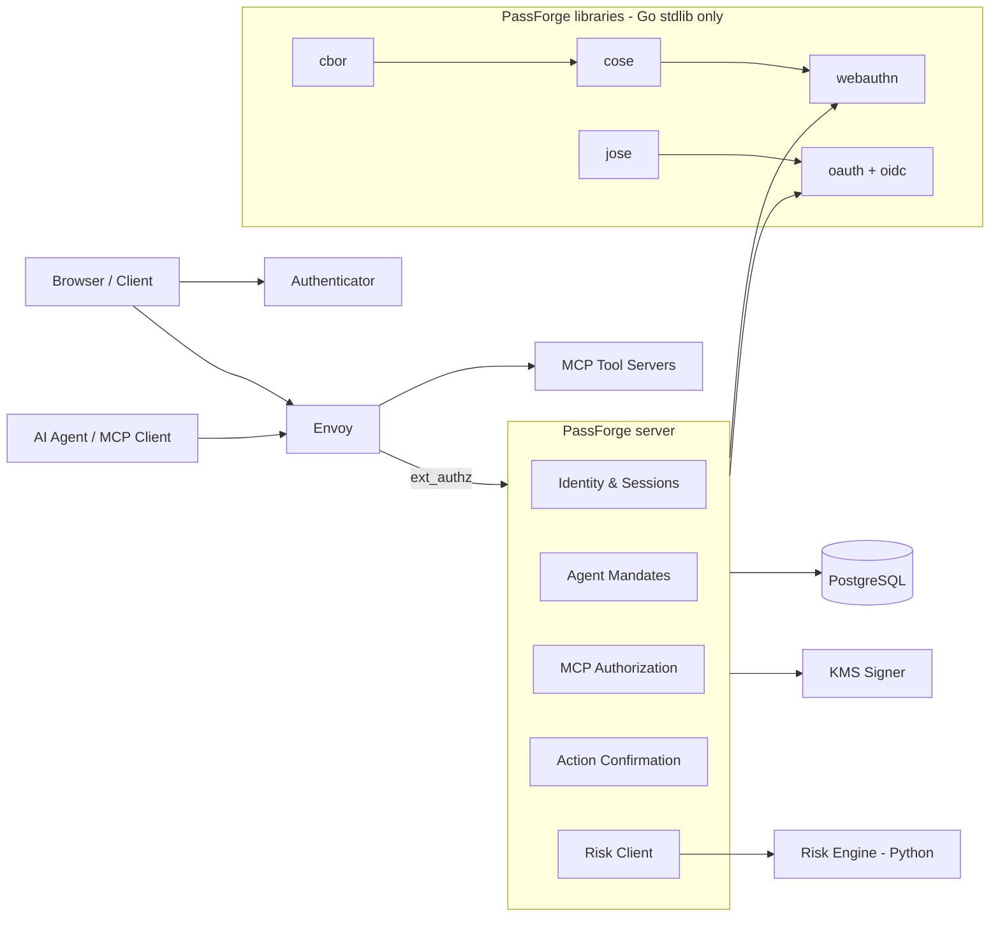

# PassForge

**Passkeys for humans, verifiable delegation for AI agents.**

PassForge is an independent, open-source identity stack written in Go:
- **Libraries:** self-built WebAuthn, OAuth 2.0 / OpenID Connect, JOSE, COSE and CBOR. Crypto primitives come only from the Go standard library.
- **Server:** an identity server built on those libraries. It adds an authorization layer for AI agents:
  - Users grant agents narrowly scoped, time-limited, revocable authority by signing a mandate with a passkey.
  - Every agent action can be checked against that mandate.
  - High-risk actions require a fresh, action-bound passkey confirmation from the human.

## Project status

> **Pre-alpha. Not for production use.**
> PassForge's protocol and parsing code is written from scratch and **has not been independently audited**.

| Release | Target | Focus |
|---|---|---|
| `v0.1` | Feb 2027 | `cbor`, `cose`, `jose`, `webauthn`, `oauth`/`oidc` modules; passkey server; OIDC provider; passkey-signed agent mandates; RFC 8693 token exchange |
| `v0.2` | Mar 2027 | MCP authorization server, human-in-the-loop action confirmation, ML risk engine, hardening |

## Objectives
- Implement WebAuthn, OAuth 2.0/OIDC, JOSE, COSE and CBOR **from the specifications**, with every behavior traced to the spec section it comes from.
- Publish them as small, standard-library-only Go modules that others can import and audit.
- Explore how WebAuthn can express **human consent for AI agent actions**, and document where it falls short today.
- Provide an open-source implementation the community can use, test against and contribute to.

## Modules

| Module | Purpose | Depends on |
|---|---|---|
| `passforge/cbor` | RFC 8949 decoder and deterministic encoder (the subset WebAuthn needs) | stdlib |
| `passforge/cose` | RFC 9052/9053 COSE_Key parsing and algorithm registry (ES256, ES384, EdDSA, RS256, PS256) | stdlib, `cbor` |
| `passforge/jose` | JWK/JWKS, JWS compact, JWT validation (RFC 7515/7517/7518/7519) with a strict algorithm allow-list | stdlib |
| `passforge/webauthn` | WebAuthn L3 relying-party library: options, ceremonies, attestation (`none`, `packed`, `fido-u2f`) | stdlib, `cbor`, `cose` |
| `passforge/oauth` | OAuth 2.0 authorization server core: code + PKCE, client auth, refresh rotation, introspection, revocation, metadata, token exchange (RFC 8693), protected-resource metadata (RFC 9728) | stdlib, `jose` |
| `passforge/oauth/oidc` | OpenID Connect: ID token, discovery, userinfo | stdlib, `jose`, `oauth` |
| `passforge/server` | PassForge server: identity, sessions, agent mandates, MCP authorization, action confirmation, risk integration | the modules above plus infrastructure deps |
| `services/risk-engine` | Python ML risk scoring service | Python stack |

### Dependency policy
- Library modules import **only the Go standard library** and each other. CI enforces this.
- No third-party identity, JOSE or CBOR libraries appear in production code. They're used only in the test-only `interop/` module, for differential testing.
- The server may use infrastructure dependencies (Postgres driver, OpenTelemetry, AWS SDK for KMS, gRPC). Each one must be justified on security, correctness, operational needs or interoperability grounds.

## Scope

### v0.1: Libraries, passkey core and agent delegation
- **WebAuthn:**
  - Registration and authentication; discoverable credentials; conditional UI.
  - Challenge management; RP ID and origin validation.
  - Synced vs device-bound credentials (backup flags, sign count).
  - Attestation: `none`, `packed`, `fido-u2f`.
- **Identity:** users, credential lifecycle, account recovery (second passkey, recovery codes), sessions, step-up authentication.
- **OAuth 2.0 / OIDC provider:**
  - Authorization code + PKCE (S256); exact redirect matching.
  - Client authentication: `none`, `client_secret_basic`, `private_key_jwt`; refresh-token rotation with reuse detection.
  - Discovery, JWKS (KMS-backed signing), ID tokens, JWT access tokens (RFC 9068), introspection, revocation.
- **Agent mandates:** scopes, resource limits and expiry, canonicalized with JCS (RFC 8785). The WebAuthn challenge is bound to the mandate hash.
- **Delegated agent tokens:** OAuth 2.0 Token Exchange (RFC 8693) with `sub` (human) and `act` (agent) claims, revocable via the mandate.
- **Gateway:** Envoy `ext_authz` integration.

### v0.2: AI agent capabilities
- **MCP authorization server:** OAuth authorization for remote Model Context Protocol tool servers, with per-tool scopes.
- **Action confirmation:** a high-risk agent action triggers a passkey assertion bound to the hash of that specific action. The result is a one-time confirmation token.
- **ML risk engine:** a Python service trained on documented synthetic data. Signals cover device, velocity, scope escalation and tool sequences. Its score drives allow / step-up / deny.
- **Hardening:** fuzzing campaign, security self-review, load test results, end-to-end demo.

### Planned / stretch
- DynamoDB storage adapter and Terraform AWS deployment (multi-region-ready design)
- Traefik ForwardAuth
- Additional attestation formats (`tpm`, `android-key`, `apple`)
- DPoP (RFC 9449)
- ONNX export of the risk model
- LLM-assisted authorization policy drafting (OPA/Rego or Cedar), with mandatory human review

### Out of scope
- Authenticator implementation
- CTAP transport
- SAML
- SCIM
- Enterprise IAM suites
- Mobile and frontend SDKs
- Formal FIDO certification
- Payment-specific flows
- Multi-region deployment: the design allows for it, but it isn't shipped in v0.2

PassForge implements the server side. Browsers and client platforms handle communication with authenticators.

## Architecture



## Technology stack
- **Libraries:** Go 1.23+, standard library only (`crypto/ecdsa`, `crypto/ed25519`, `crypto/rsa`, `crypto/x509`, `crypto/sha256`, `crypto/subtle`, `crypto/rand`)
- **Server:** Go, PostgreSQL (`golang-migrate`), KMS signer interface (local key / AWS KMS via LocalStack), OpenTelemetry, Envoy
- **Risk engine:** Python 3.11+, FastAPI, Pydantic 2, scikit-learn, pytest
- **Platform and testing:**
  - Docker, Tilt + kind (Kubernetes), LocalStack, Terraform
  - Go fuzzing, Playwright (virtual authenticator), k6, OpenID Foundation conformance suite

## Correctness and conformance
- **Spec test vectors:**
  - RFC 8949 Appendix A (CBOR)
  - RFC 9052/9053 (COSE)
  - RFC 7520 (JOSE)
  - WebAuthn L3 test vectors
  - RFC 7636 Appendix B (PKCE)
- **Fuzzing:** every parser has fuzz targets (CBOR, COSE_Key, authenticatorData, clientDataJSON, JWS/JWT).
- **Differential testing:** results are compared against established implementations in the test-only `interop/` module.
- **Conformance:** OpenID Foundation conformance suite results are published per release in `docs/standards/`.
- **Traceability:** each implemented MUST/SHOULD maps to code and a test in [TRACEABILITY.md](docs/standards/TRACEABILITY.md).

## Standards baseline

Primary normative references. The exact revision used for each milestone is recorded in [TRACEABILITY.md](docs/standards/TRACEABILITY.md).

- [W3C Web Authentication (WebAuthn) Level 3](https://www.w3.org/TR/webauthn-3/)
- [FIDO2 Specifications](https://fidoalliance.org/specifications/) and [FIDO Server Requirements](https://fidoalliance.org/certification/functional-certification/functional-certification-servers/)
- CBOR and COSE: RFC 8949, RFC 9052, RFC 9053
- JOSE: RFC 7515, RFC 7517, RFC 7518, RFC 7519, RFC 8785 (JCS)
- OAuth 2.0:
  - RFC 6749 (core)
  - RFC 7636 (PKCE)
  - RFC 7009 (revocation)
  - RFC 7662 (introspection)
  - RFC 8414 (AS metadata)
  - RFC 8693 (Token Exchange)
  - RFC 9068 (JWT access tokens)
  - RFC 9207 (`iss` in authorization responses)
  - RFC 9728 (Protected Resource Metadata)
- OpenID Connect Core 1.0 and Discovery 1.0
- Model Context Protocol: authorization specification (version pinned per milestone)
- Relevant IANA registries (COSE algorithms, WebAuthn extensions, OAuth parameters)

## Roadmap

```text
M0 Foundations → M1 cbor/cose/jose → M2 webauthn + passkey server → M3 oauth/oidc + gateway
→ M4 Agent delegation (v0.1) → M5 MCP auth + action confirmation → M6 ML risk engine → M7 Hardening (v0.2)
```

## Independent implementation and AI assistance
- [PROVENANCE.md](docs/governance/PROVENANCE.md)

PassForge is a personal, independent project. It contains no employer code, data or confidential information.

AI tools are used as an assistant: explaining specifications, scaffolding tests from spec vectors, and reviewing diffs. The maintainer makes all design and spec-interpretation decisions and reviews every change. See [PROVENANCE.md](docs/governance/PROVENANCE.md) for details.

## Security
- Pre-alpha, self-implemented protocol code that has not been independently audited. **Do not use it to protect real accounts.**
- A threat model covering human and agent flows is in [docs/threat-model](docs/threat-model/).
- Report vulnerabilities as described in [SECURITY.md](./SECURITY.md).

## Contributing
- [CONTRIBUTING.md](./CONTRIBUTING.md)

## License
PassForge is released under the [Apache License 2.0](LICENSE).

## Disclaimer
PassForge is an independent open-source project. It is not affiliated with, endorsed by, or certified by the W3C, the FIDO Alliance, the OpenID Foundation, or any employer unless explicitly stated in project documentation.
